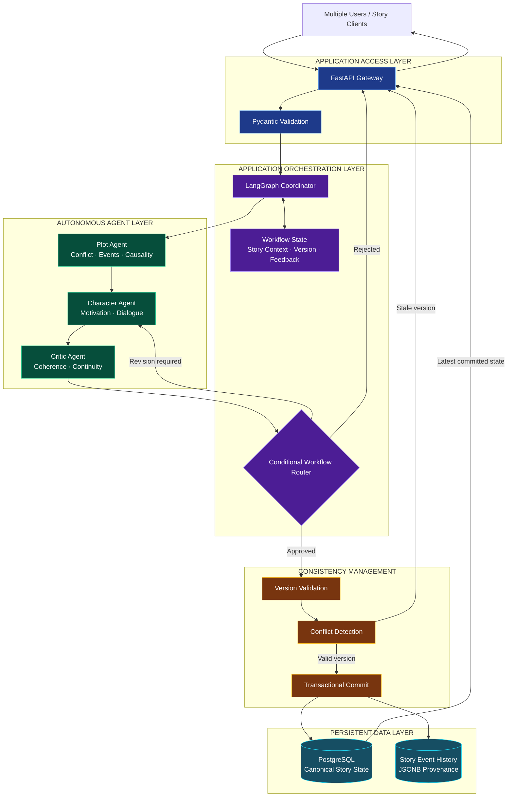
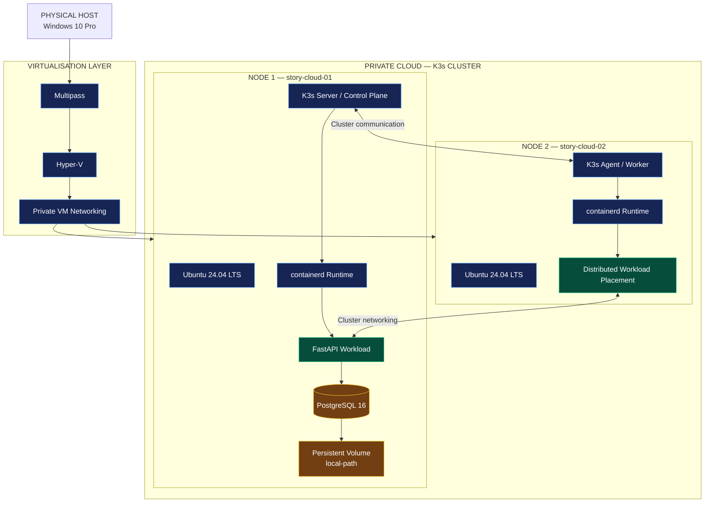
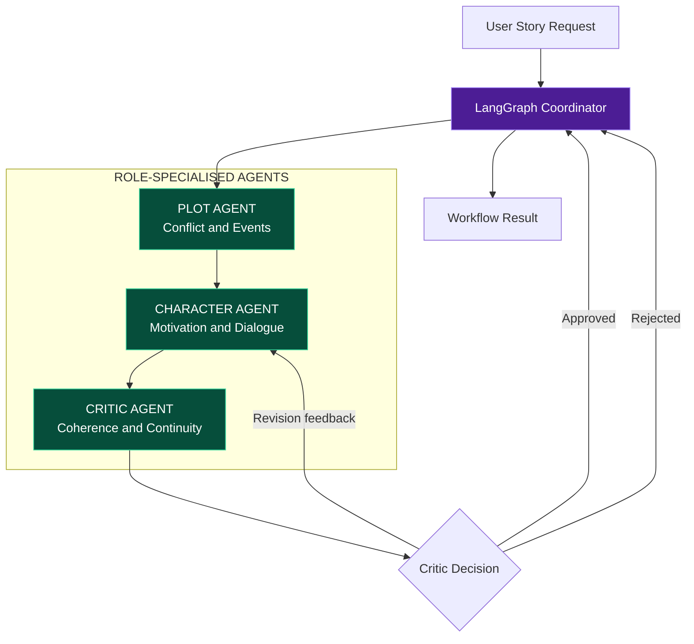
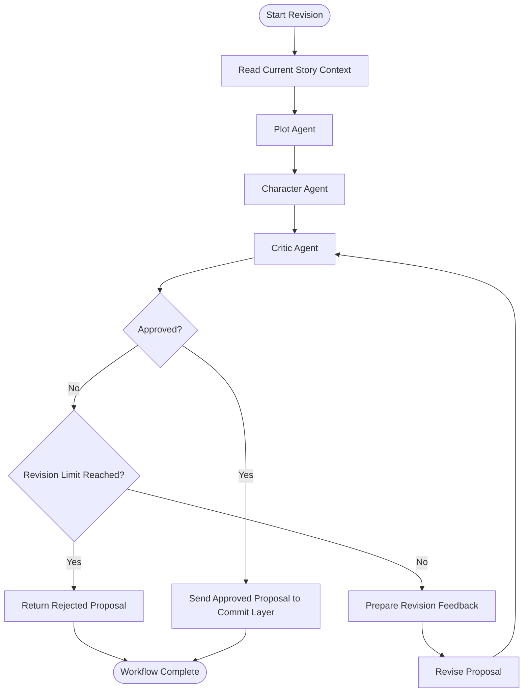
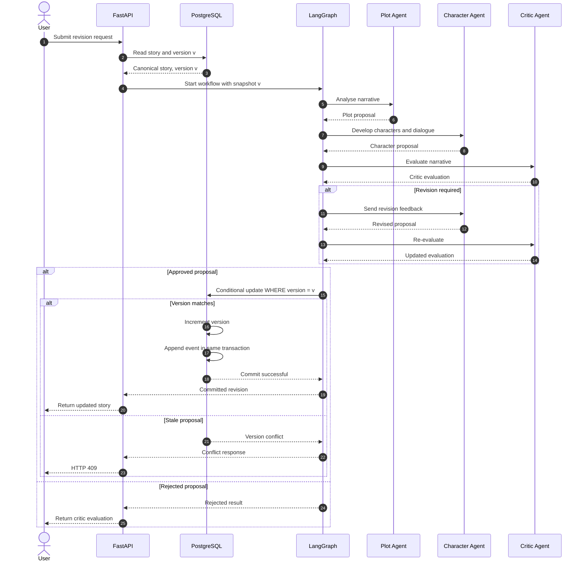

# Consistency-Aware Distributed Multi-Agent Storytelling Cloud

### A Private Kubernetes Cloud for Autonomous Multi-Agent Collaboration, Narrative Consistency and Distributed State Management

<p align="center">
  <strong>Research & Engineering Project</strong><br/>
  CO4219 / CO7219 — Internet and Cloud Computing
</p>

<p align="center">
  Python 3.12 · FastAPI · LangGraph · Gemini · PostgreSQL · K3s · Kubernetes · Multipass · Buildah
</p>

---

## 1. Project Overview

The **Consistency-Aware Distributed Multi-Agent Storytelling Cloud** is a research-oriented distributed application that investigates how autonomous AI agents can collaboratively generate, evaluate and revise a shared narrative while operating within a private cloud infrastructure.

The system decomposes storytelling into specialised autonomous responsibilities rather than relying on a single language-model interaction. Multiple agents independently analyse narrative context, propose developments, evaluate contributions and revise content according to structured feedback.

A coordination layer manages agent execution, while PostgreSQL maintains an authoritative, version-controlled representation of the shared story.

The infrastructure is built using two Ubuntu virtual machines provisioned through Multipass and connected through a lightweight Kubernetes cluster powered by K3s.

The project combines five key engineering domains:

- **Distributed systems:** Multi-node deployment, inter-service communication and workload coordination.
- **Multi-agent artificial intelligence:** Role-specialised autonomous agents collaborating on narrative generation.
- **Application orchestration:** LangGraph-based workflow management and conditional agent transitions.
- **Data consistency:** Transactional updates, version validation and conflict detection.
- **Cloud infrastructure:** Private virtualised infrastructure, containerisation, Kubernetes scheduling and persistent storage.

The central research objective is to understand the trade-offs between autonomous agent coordination, shared-state consistency, narrative coherence and distributed-system performance.

## 2. Problem Statement

Collaborative AI storytelling introduces a coordination problem when multiple autonomous agents independently analyse and modify the same narrative.

Each agent may operate using a different interpretation of the existing story. Concurrent proposals can introduce contradictory events, inconsistent character motivations, duplicated developments or revisions based on outdated information.

These challenges become more significant when agents execute independently across containers or virtual machines and communicate over a distributed network.

A shared database alone does not guarantee narrative consistency. Concurrent writers may overwrite one another, stale proposals may be accepted, and users may observe different versions of the same story.

Consequently, a distributed storytelling application requires mechanisms that coordinate agent reasoning, validate proposed changes, preserve a canonical shared state and manage concurrent updates.

**Core problem statement:**

How can a distributed multi-agent application coordinate autonomous narrative generation and concurrent modifications while preserving an authoritative, coherent shared story state, and what consistency, availability and performance trade-offs arise from the coordination mechanisms?

### 2.1 Challenges addressed

| Challenge | Engineering response |
|---|---|
| Conflicting agent contributions | Role-based agent coordination and critic evaluation |
| Narrative contradictions | Structured coherence and continuity assessment |
| Concurrent story updates | Version-based optimistic concurrency control |
| Stale agent proposals | Conditional transactional commits |
| Shared-state management | PostgreSQL canonical story representation |
| Unbounded agent revisions | Bounded revision policy |
| Distributed workload execution | Kubernetes-based deployment architecture |
| Resource constraints | Kubernetes requests, limits and resource quotas |
| Unobservable execution | Planned monitoring and experimental instrumentation |

## 3. Research Question, Hypothesis and Objectives

### 3.1 Primary research question

How do agent coordination and shared-state consistency mechanisms affect narrative coherence, throughput, latency, scalability and fault tolerance in a distributed multi-agent storytelling system?

### 3.2 Research hypothesis

Explicit agent coordination combined with version-controlled transactional shared-state updates should reduce conflicting narrative modifications and improve the consistency of accepted story revisions.

However, proposal validation, critique, coordination, retries and transactional commits may introduce additional processing overhead, potentially affecting throughput and response latency.

The hypothesis will be evaluated through controlled experiments rather than assuming that stronger consistency always provides the best overall system performance.

### 3.3 Research objectives

1. Design a private cloud architecture for distributed multi-agent storytelling.
2. Implement independently deployable and role-specialised agent services.
3. Develop an explicit application-level coordination workflow.
4. Maintain an authoritative and persistent shared narrative state.
5. Implement transactional updates and version-based conflict detection.
6. Support multiple users and concurrent revision requests.
7. Investigate horizontal scaling and resource-aware workload management.
8. Evaluate narrative coherence, consistency, latency, throughput and fault recovery.
9. Analyse CAP-related trade-offs, architectural limitations and operational costs.

## 4. System Architecture

The architecture separates cloud infrastructure, application access, agent reasoning, workflow orchestration, consistency management and persistent data storage.

Two distinct orchestration mechanisms are used:

- **Kubernetes/K3s:** Infrastructure-level orchestration of container workloads.
- **LangGraph:** Application-level orchestration of autonomous agent execution.

These mechanisms have different responsibilities and are not interchangeable.

### 4.1 High-level logical architecture



This is the logical application architecture. It does not imply that every component is already independently deployed as a container.

## 5. Private Cloud Infrastructure Architecture

### 5.1 Physical and virtual infrastructure

The private cloud is hosted on a Windows development machine using Hyper-V virtualisation and Multipass for Ubuntu virtual-machine management.

The two-node K3s environment provides the infrastructure foundation for distributed container workloads.



### 5.2 Infrastructure configuration

| Component | Configuration / responsibility |
|---|---|
| Physical host | Windows 10 Pro |
| Virtualisation | Hyper-V |
| VM management | Multipass 1.17 |
| Operating system | Ubuntu 24.04 LTS |
| Node 1 | `story-cloud-01` |
| Node 2 | `story-cloud-02` |
| Kubernetes distribution | K3s |
| Container runtime | containerd |
| Image builder | Buildah |
| Database | PostgreSQL 16 |
| Storage provisioner | K3s local-path |
| Database storage | 5 GiB PVC, ReadWriteOnce |
| Application namespace | `storytelling` |

The current environment is a two-node research cluster, not a production high-availability Kubernetes or database deployment.

### 5.3 Infrastructure responsibilities

**Multipass and Hyper-V**

Provide virtual-machine provisioning, isolation and lifecycle management.

**K3s**

Manages Kubernetes resources, scheduling and deployment across the registered nodes.

**containerd**

Executes container images within the Kubernetes nodes.

**Buildah**

Builds OCI-compatible application images independently of the Kubernetes runtime.

**PostgreSQL**

Provides persistent storage for the canonical story and revision history.

## 6. Distributed Multi-Agent Architecture

The application uses three specialised agent roles coordinated by LangGraph.

Each agent has a distinct reasoning responsibility and returns structured output validated through Pydantic schemas.

### 6.1 Plot Agent

The Plot Agent analyses the existing narrative and user requirements.

Its responsibilities include:

- Identifying the central narrative conflict.
- Proposing causally connected story events.
- Evaluating unresolved narrative questions.
- Maintaining alignment with existing story context.

**Output:** Structured plot proposal.

### 6.2 Character Agent

The Character Agent develops the narrative using the plot proposal and critic feedback.

Its responsibilities include:

- Character development.
- Character motivations.
- Dialogue generation.
- Narrative continuation.
- Addressing identified continuity issues.

**Output:** Structured character and continuation proposal.

### 6.3 Critic Agent

The Critic Agent independently evaluates the proposed narrative changes.

Its responsibilities include:

- Narrative coherence assessment.
- Character continuity validation.
- Causal consistency analysis.
- Identification of contradictions.
- Revision recommendations.
- Approval or rejection of the proposal.

**Output:** Structured critic evaluation containing approval status, coherence score, continuity issues, causal issues and revision instructions.

### 6.4 Agent interaction architecture



The logical separation of agents is implemented in the application code. Independent container deployment and placement across both cloud nodes remain deployment objectives.

## 7. Application Orchestration Using LangGraph

LangGraph represents the multi-agent application as a stateful directed workflow.

The workflow controls the execution sequence, preserves intermediate proposals, manages feedback and applies bounded revision policies.

### 7.1 Workflow state

The current workflow state includes:

- Story title.
- Current story content.
- User request.
- Plot proposal.
- Character proposal.
- Critic evaluation.
- Revision feedback.
- Revision attempt counter.
- Critic evaluation counter.
- Workflow status.

### 7.2 Workflow transitions



The current workflow has a maximum of two revision attempts. It terminates with an approved or rejected result rather than executing unlimited revision cycles.

### 7.3 Orchestration versus infrastructure scheduling

| Responsibility | Mechanism |
|---|---|
| Agent reasoning | Gemini model integration |
| Agent workflow transitions | LangGraph |
| Structured state validation | Pydantic |
| Application API | FastAPI |
| Container scheduling | Kubernetes |
| Cluster workload management | K3s |
| Container execution | containerd |
| Shared persistent state | PostgreSQL |

## 8. Shared-State Consistency Architecture

A central challenge is ensuring that accepted agent contributions are based on a valid version of the canonical story.

### 8.1 Authoritative shared story

PostgreSQL acts as the authoritative writer for story state.

The current data model contains two principal entities.

**Story**

- UUID identifier.
- Story title.
- Current narrative content.
- Version number.
- Creation timestamp.
- Updated timestamp.

**StoryEvent**

- Event identifier.
- Story identifier.
- Committed version.
- Agent identifier.
- Event type.
- Structured JSONB payload.
- Creation timestamp.

This separates the current canonical story from its revision and event history.

### 8.2 Optimistic concurrency control

The application implements version-based conflict detection through a conditional SQL update.

```sql
UPDATE stories
SET
    content = :new_content,
    version = version + 1
WHERE
    id = :story_id
    AND version = :expected_version
RETURNING version;
```

The update succeeds only when the current database version equals the proposal's expected version.

If another request has already committed a newer version, the conditional update returns no matching row and the application rejects the stale proposal.

The story update and corresponding StoryEvent are written in the same transaction.

### 8.3 Versioned Proposal–Critique–Commit (VPCC)

The project uses the name **Versioned Proposal–Critique–Commit (VPCC)** to describe its application-specific coordination workflow.

VPCC is a project-defined design, not a claim of a new formal consensus algorithm.

Its stages are:

1. **Read:** retrieve the canonical story and version.
2. **Propose:** agents generate candidate developments.
3. **Critique:** the critic evaluates continuity and coherence.
4. **Revise:** feedback is returned to the relevant agent.
5. **Validate:** verify that the proposal is based on the latest version.
6. **Commit:** perform a conditional transactional update.
7. **Verify:** expose the latest committed story to subsequent readers.

### 8.4 Consistency protocol sequence



### 8.5 Transaction boundaries

The language-model execution is performed outside the final database transaction.

This avoids holding database locks while waiting for potentially slow external model responses.

The final database transaction is used only for:

- Validating the expected story version.
- Updating the canonical story.
- Incrementing the version.
- Appending the corresponding event record.

This design reduces the duration of database transactions while retaining conditional commit semantics.

## 9. CAP Theorem and Distributed-System Trade-offs

The CAP theorem describes the consistency and availability trade-offs that arise when a distributed system experiences a network partition.

The project favours consistency for authoritative story updates.

If a proposal cannot be validated against the canonical state, the application rejects or defers the authoritative write rather than allowing divergent versions to be committed.

This design prioritises:

- An authoritative shared story.
- Version-validated writes.
- Detection of stale updates.
- Atomic story and event persistence.

However, the approach introduces availability limitations.

| Scenario | Expected behaviour |
|---|---|
| Normal operation | Valid proposals can be committed |
| Concurrent updates | Stale proposals are rejected |
| Database unavailable | Authoritative writes cannot complete |
| Database network partition | Commit validation may fail |
| Agent failure | Workflow execution may fail or require retry |
| Worker node failure | Workloads on that node may become unavailable |

The current deployment uses one PostgreSQL instance and does not provide database high availability.

Optimistic concurrency control is not distributed consensus. The system does not claim to maintain authoritative write availability during database isolation.

## 10. Technology Stack

### 10.1 Programming languages

| Language | Usage |
|---|---|
| Python 3.12 | Application, agents, API and tests |
| SQL | Relational data model and transactional operations |
| YAML | Kubernetes manifests and configuration |
| PowerShell | Windows infrastructure administration |
| Markdown | Research and technical documentation |

### 10.2 AI and application technologies

| Technology | Purpose |
|---|---|
| Python | Application runtime |
| FastAPI | REST API framework |
| LangGraph | Multi-agent workflow orchestration |
| LangChain Google GenAI | Gemini integration |
| Gemini 3.6 Flash | Tested language model |
| Pydantic | Structured validation and schemas |
| SQLAlchemy | ORM and database transactions |
| Psycopg | PostgreSQL driver |
| Alembic | Database migration tooling |
| Uvicorn | ASGI server |
| Pytest | Automated testing |
| HTTPX | HTTP client and testing |

### 10.3 Cloud and infrastructure technologies

| Technology | Purpose |
|---|---|
| Windows 10 Pro | Physical development host |
| Hyper-V | Virtualisation |
| Multipass | Virtual-machine provisioning |
| Ubuntu 24.04 LTS | Cloud-node operating system |
| K3s | Lightweight Kubernetes distribution |
| Kubernetes | Container workload orchestration |
| containerd | Container runtime |
| Buildah | OCI image construction |
| PostgreSQL 16 | Persistent shared-state database |
| Kubernetes PVC | Persistent volume allocation |
| ResourceQuota | Namespace resource constraints |
| LimitRange | Default and maximum resource policies |
| Git | Source control |
| GitHub | Repository hosting and version history |

## 11. Repository Structure

```text
Distributed-multi-agent-storytelling-cloud/
│
├── app/
│   ├── agents/
│   │   ├── graph.py
│   │   ├── model.py
│   │   ├── schemas.py
│   │   └── story_agents.py
│   │
│   ├── api/
│   │   ├── main.py
│   │   └── routes/
│   │       └── stories.py
│   │
│   ├── core/
│   │   └── config.py
│   │
│   ├── db/
│   │   └── models.py
│   │
│   ├── schemas/
│   │   └── story.py
│   │
│   └── services/
│       ├── agent_workflow_service.py
│       └── story_service.py
│
├── docs/
│   └── Architecture and research documentation
│
├── experiments/
│   └── Experimental configurations and results
│
├── evidence/
│   └── Implementation and evaluation evidence
│
├── k8s/
│   └── Kubernetes manifests
│
├── migrations/
│   └── Database migration scripts
│
├── scripts/
│   └── Development and verification scripts
│
├── tests/
│   └── Automated application and workflow tests
│
├── .env.example
├── .gitignore
├── alembic.ini
├── Containerfile
├── pytest.ini
├── requirements.in
├── requirements.lock
├── VERSION
└── README.md
```

## 12. Local Development and Execution

### 12.1 Prerequisites

- Python 3.12.
- Git.
- Access to a PostgreSQL instance.
- Gemini API credentials for the configured model integration.
- Windows, Linux or macOS development environment.

### 12.2 Clone the repository

```bash
git clone https://github.com/VIGNESH-MT/Distributed-multi-agent-storytelling-cloud.git

cd Distributed-multi-agent-storytelling-cloud
```

### 12.3 Create a virtual environment

Windows PowerShell:

```powershell
py -3.12 -m venv .venv

.\.venv\Scripts\Activate.ps1
```

Linux/macOS:

```bash
python3.12 -m venv .venv

source .venv/bin/activate
```

### 12.4 Install dependencies

```bash
python -m pip install --upgrade pip

pip install --require-hashes -r requirements.lock
```

### 12.5 Configure environment variables

Windows:

```powershell
Copy-Item .env.example .env
```

Linux/macOS:

```bash
cp .env.example .env
```

Configure the local PostgreSQL connection and model credentials.

Example:

```dotenv
POSTGRES_HOST=127.0.0.1
POSTGRES_PORT=15432
POSTGRES_DB=storytelling
POSTGRES_USER=storyapp
POSTGRES_PASSWORD=replace_with_your_local_secret

GEMINI_API_KEY=replace_with_your_api_key
GEMINI_MODEL=gemini-3.6-flash
```

Never commit `.env` or publish API credentials.

### 12.6 Run the local application

```bash
python -m uvicorn app.api.main:app --host 127.0.0.1 --port 8000 --reload
```

Open:

| URL | Purpose |
|---|---|
| http://127.0.0.1:8000/ | Redirects to API documentation |
| http://127.0.0.1:8000/docs | Interactive Swagger API |
| http://127.0.0.1:8000/health | Application health and version |
| http://127.0.0.1:8000/health/live | Liveness check |
| http://127.0.0.1:8000/health/ready | Readiness check |

### 12.7 Application endpoints

| Endpoint | Method | Purpose |
|---|---|---|
| `/health` | GET | Application health |
| `/health/live` | GET | Liveness |
| `/health/ready` | GET | Readiness |
| `/stories` | POST | Create a story |
| `/stories/{story_id}` | GET | Retrieve a story |
| `/stories/{story_id}/revisions` | POST | Submit a version-controlled revision |
| `/stories/{story_id}/agentic-revisions` | POST | Execute an agentic revision workflow |

The interactive Swagger documentation provides the available request and response schemas.

## 13. Containerisation and Kubernetes Deployment

The application is packaged using Buildah and executed by the K3s containerd runtime.

The Containerfile uses:

- Python 3.12 slim base image.
- Hash-locked dependency installation.
- Dedicated non-root application user.
- Minimal runtime dependencies.
- Uvicorn application startup.

Buildah and containerd maintain separate image stores. Consequently, a locally built image must be explicitly imported into containerd or distributed through an image registry before Kubernetes can deploy it.

### 13.1 Kubernetes design

The application deployment is designed around:

- Explicit CPU and memory requests.
- CPU and memory limits.
- Health and readiness probes.
- Non-root execution.
- Read-only root filesystem.
- Kubernetes Secrets for credentials.
- Persistent volumes for database data.
- Separate application and infrastructure orchestration.

### 13.2 Resource governance

The storytelling namespace uses Kubernetes ResourceQuota and LimitRange policies to constrain workload resource consumption.

This provides a controlled environment for evaluating how agent workloads behave under limited CPU and memory availability.

### 13.3 Deployment topology

The target deployment places independently running agent services across the two K3s nodes.

The complete distributed application rollout and agent placement remain deployment milestones. The existence of two Kubernetes nodes alone does not demonstrate that all agent services are independently deployed across both nodes.

### 13.4 Google Cloud (GKE) deployment

A second deployment target runs the same image on a regional, private-node GKE cluster inside a dedicated VPC, with Cloud SQL for PostgreSQL (private IP), Artifact Registry, a global load balancer, per-service HorizontalPodAutoscalers and Cloud Monitoring.

- Manifests: `k8s/gke/`
- Provisioning, build, deploy and teardown scripts: `scripts/gcp/`
- Concurrency and throughput experiments: `scripts/load_test.py`
- Step-by-step guide: [`docs/gcp-deployment.md`](docs/gcp-deployment.md)

## 14. Testing and Verification

The project uses application-level automated tests and infrastructure-level verification.

### 14.1 Application tests

Current regression tests cover:

- API health behaviour.
- Story service operations.
- Structured agent output validation.
- Required character dialogue.
- Critic approval behaviour.
- Bounded revision attempts.
- Revision feedback propagation.
- Transactional story commits.
- Stale-version rejection.
- Missing-story handling.

Run:

```bash
pytest -v
```

**Current verified regression checkpoint: 10 passing tests.**

### 14.2 Infrastructure tests

Infrastructure verification includes:

- Multipass VM status.
- K3s node readiness.
- Kubernetes deployment status.
- PostgreSQL health.
- Persistent volume binding.
- Database authentication.
- Persistence across PostgreSQL pod replacement.
- Container image build and import.

A database persistence probe has survived PostgreSQL pod replacement using the same persistent volume.

This verifies persistence across pod replacement on the same node and volume. It does not establish recovery from node failure, disk failure or database-instance failure.

## 15. Experimental Methodology

The project will evaluate the effects of agent coordination and consistency mechanisms using controlled, repeatable workloads.

### 15.1 Experimental conditions

| Condition | Coordination mechanism |
|---|---|
| Baseline | Independent updates with a last-write-wins comparison |
| Experiment A | Proposal and critic workflow |
| Experiment B | Proposal, critic and version-checked transactional commit |

The comparison is intended to identify the effect of coordination and conflict detection on narrative quality and system performance.

### 15.2 Performance metrics

| Metric | Measurement objective |
|---|---|
| Throughput | Successfully committed revisions per unit time |
| p50 latency | Median end-to-end revision latency |
| p95 latency | Tail revision latency |
| Conflict rate | Rejected stale or conflicting updates |
| Commit success rate | Successful transactional updates |
| Retry count | Additional work caused by revision or conflict handling |
| Narrative coherence | Structured evaluation of accepted story revisions |
| CPU utilisation | Compute consumption by workloads |
| Memory utilisation | Memory consumption across nodes |
| Recovery time | Time required to resume after controlled failure |

### 15.3 Narrative coherence assessment

Narrative coherence should be evaluated using an explicit rubric rather than relying exclusively on a language model's subjective approval.

Potential dimensions include:

- Character continuity.
- Event consistency.
- Causal relationships.
- Temporal consistency.
- Contradiction detection.
- Alignment with user requirements.

The scoring procedure should use documented criteria and repeatable prompts.

### 15.4 Concurrency experiments

Planned experiments include:

1. Concurrent revision requests against the same story version.
2. Stale proposal rejection.
3. Multiple users retrieving the latest committed state.
4. Agent interruption and recovery.
5. Horizontal scaling of agent workloads.
6. Database unavailability.
7. Network interruption.
8. Increasing concurrent request workloads.

### 15.5 Experimental reproducibility

Each experiment should record:

- Configuration and software versions.
- Workload size and concurrency.
- Number of trials.
- Initial story state.
- Coordination condition.
- Raw latency measurements.
- Commit and conflict outcomes.
- Resource utilisation.
- Failure and recovery observations.

Performance results must be measured and documented before any scalability or reliability improvement is claimed.

## 16. Security, Reliability and Operational Considerations

Security and reliability are important because the system combines external AI model APIs, distributed services and persistent user-generated content.

Current and planned safeguards include:

- API credentials stored outside source code.
- Kubernetes Secret-based configuration.
- Non-root container execution.
- Read-only container root filesystem.
- Explicit resource limits.
- Structured request validation.
- Transactional persistence.
- Version-based conflict detection.
- Health and readiness endpoints.
- Reproducible dependency installation.
- Auditable story event records.

The current environment is a research deployment rather than a production-grade high-availability platform.

Further work includes:

- Database backup and restore verification.
- Encrypted secret storage at rest.
- Network policies and service isolation.
- Stronger user authentication and authorisation.
- Database redundancy and failover.
- More comprehensive security testing.

## 17. Limitations and Future Research

### 17.1 Distributed agent deployment

Independent deployment and scheduling of the agent services across multiple Kubernetes nodes must be demonstrated and evaluated.

### 17.2 Database availability

The current PostgreSQL deployment is a single instance and therefore represents a single point of failure.

A replicated database architecture and tested recovery procedure would improve availability.

### 17.3 Coordination overhead

Proposal generation, critique and version validation may increase response latency. Their performance impact requires comparison against simpler coordination approaches.

### 17.4 Model reliability

Language models can produce incomplete or inconsistent output. Structured schemas and critic feedback reduce some risks but do not guarantee semantic correctness.

### 17.5 Horizontal scaling

Resource-aware scaling requires monitoring, explicit resource bounds and deployment verification.

Infrastructure scaling and intelligent agent reasoning must remain separate responsibilities.

### 17.6 User interface

A dedicated graphical storytelling interface is a planned application layer beyond the current API documentation and endpoints.

### 17.7 Further research directions

- Multi-user collaborative story sessions.
- Real-time shared-state notifications.
- Independent agent scaling.
- Prometheus and Grafana monitoring.
- Automated resource-aware scaling.
- Database recovery and resilience experiments.
- Improved agent provenance.
- Comparative consistency and availability policies.
- Energy-aware workload scheduling.

## 18. Societal, Ethical and Environmental Considerations

The system uses generative AI to create narrative content. Its evaluation should consider:

- Harmful or biased generated content.
- Ownership and attribution of AI-generated material.
- Privacy of user prompts and narrative data.
- External model-provider data-handling policies.
- Reliability of generated information.
- Energy and compute costs of repeated agent execution.
- Resource efficiency during horizontal scaling.

Synthetic story data should be preferred for experiments.

External model API terms and data-handling policies should be reviewed before sending user-provided content.

Resource utilisation should be measured alongside throughput so that performance improvements are not evaluated independently of their computational cost.

## 19. Current Implementation Status

This table distinguishes completed implementation work from remaining engineering and research objectives.

| Workstream | Status |
|---|---|
| Research problem and architecture | Designed |
| Multipass virtual machines | Established |
| Two-node K3s cluster | Operational |
| PostgreSQL persistent storage | Deployed and tested |
| FastAPI application | Implemented |
| Plot Agent | Implemented |
| Character Agent | Implemented |
| Critic Agent | Implemented |
| LangGraph workflow | Implemented and tested |
| Bounded revision feedback | Implemented and tested |
| Version-checked transactional commits | Implemented and tested |
| Gemini model connectivity | Verified |
| Container image 0.1.1 | Built and imported into VM1 |
| Image distribution to VM2 | Pending |
| Complete Kubernetes application rollout | Pending |
| Independent agent deployment across nodes | Pending |
| Graphical storytelling interface | Pending |
| Live multi-user synchronisation | Pending |
| Monitoring and dynamic scaling | Pending |
| Comparative performance experiments | Pending |
| Final demonstration and critical review | Pending |

**Implementation status is not equivalent to research validation.** A working component does not establish a performance improvement until the corresponding experiment has been conducted.

## 20. Research Reproducibility and Evidence

The repository is intended to maintain a reproducible record of:

- Application source code.
- Dependency versions and hashes.
- Container build instructions.
- Kubernetes configuration.
- Database schema and migrations.
- Automated test results.
- Experimental configurations.
- Raw measurements and analysis.
- Architecture and deployment evidence.

Experimental reports should include sufficient configuration and workload information to allow another researcher to reproduce the evaluation.

## 21. Project Information

**Author:** Vignesh Murugesan

**Email:** vigneshmurugesan8588@gmail.com

**Project:** Consistency-Aware Distributed Multi-Agent Storytelling Cloud

**Module:** CO4219 / CO7219 — Internet and Cloud Computing

**Project type:** Individual research and engineering implementation

**Repository:**  
https://github.com/VIGNESH-MT/Distributed-multi-agent-storytelling-cloud

**Research areas:**

- Distributed systems.
- Autonomous multi-agent systems.
- Consistency-aware application design.
- Cloud-native infrastructure.
- Transactional state management.
- AI coordination and evaluation.
- Performance and fault-tolerance analysis.

## 22. AI Use and Academic Integrity

Generative AI tools may be used during software design, implementation, debugging and testing in accordance with the coursework's stated AI-use policy.

Their use should be explicitly disclosed in the coursework submission.

The assessed academic report must be written in the student's own words and comply with the module's requirements concerning AI-generated content, references and academic integrity.

---

<p align="center">
  <strong>Consistency-Aware Distributed Multi-Agent Storytelling Cloud</strong><br/>
  Researching autonomous collaboration, transactional shared state and distributed cloud execution.
</p>
