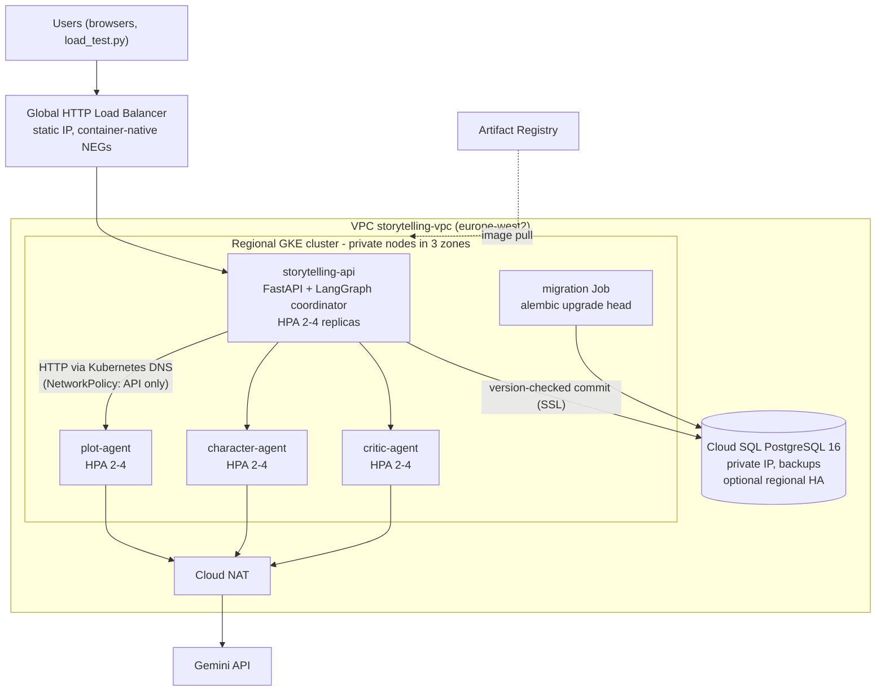

# Deploying the Storytelling Cloud on Google Cloud (GKE)

This guide deploys the system on Google Cloud as a **virtual private cloud**:
a dedicated VPC in which the Kubernetes nodes and the database have private
IP addresses only. The only public entry point is an HTTP load balancer.

The original two-node K3s/Multipass environment (`k8s/storytelling-api.yaml`
and the `*-agent.yaml` files in the repository root) is unchanged and can be
described in the report as the first iteration of the private cloud.

## 1. Target architecture



| Brief requirement | Google Cloud implementation |
|---|---|
| Compute | Regional GKE cluster, one `e2-standard-2` node per zone, cluster autoscaler (3-4 nodes) |
| Container orchestration | GKE (Kubernetes), Deployments, rolling updates, PodDisruptionBudgets |
| Storage / shared state | Cloud SQL for PostgreSQL 16 (canonical story + event history), automated backups |
| Networking | Custom VPC, VPC-native pod/service ranges, private nodes, Cloud NAT, Private Service Access |
| Service discovery | Kubernetes DNS (`storytelling-plot-agent:8000`, ...) via ClusterIP Services |
| Unified service for users | One static IP on a global load balancer routing to any API replica |
| Dynamic scaling | HorizontalPodAutoscaler per service + node autoscaling |
| Fault tolerance | Replicas spread across zones and nodes, probes, PDBs, regional control plane, optional Cloud SQL HA |
| Quality of service | CPU/memory requests and limits, ResourceQuota, LimitRange |
| Security | Least-privilege node service account, NetworkPolicy, Secret Manager, non-root read-only containers, no public IPs on nodes/DB |
| Monitoring | Cloud Logging, Cloud Monitoring, Managed Prometheus, kube-state metrics for pods/deployments/HPA |

## 2. Before you start

1. A Google Cloud project with **billing enabled** (the free trial's $300
   credit is enough for the coursework if you tear down when finished).
2. **Set a budget alert**: Console > Billing > Budgets & alerts > Create budget
   (e.g. 50 USD with email alerts at 50 / 90 / 100 %).
3. A **Gemini API key** (Google AI Studio) if you want real LLM agents.
4. Free-trial accounts can run **at most 8 vCPUs** at once. The defaults
   (3-4 x `e2-standard-2`) respect that.

Approximate running cost with the defaults is in the order of 10 USD per day
(regional cluster management fee, three nodes, Cloud SQL `db-g1-small`, load
balancer and NAT). Check the
[pricing calculator](https://cloud.google.com/products/calculator) and always
run the teardown script when you stop working for more than a day.

## 3. Get the code into Cloud Shell

All scripts are written for **Google Cloud Shell**, which already has
`gcloud`, `kubectl`, `docker`, `git` and `python3`.

1. Commit and push the repository (Cloud Shell clones it from GitHub):
   ```powershell
   git add -A
   git commit -m "Add GKE deployment"
   git push
   ```
2. Open <https://console.cloud.google.com>, select your project and click
   **Activate Cloud Shell** (the `>_` icon, top right).
3. In Cloud Shell:
   ```bash
   git clone https://github.com/VIGNESH-MT/Distributed-multi-agent-storytelling-cloud.git
   cd Distributed-multi-agent-storytelling-cloud
   cp scripts/gcp/config.env.example scripts/gcp/config.env
   nano scripts/gcp/config.env      # set PROJECT_ID at minimum, then Ctrl+O, Enter, Ctrl+X
   chmod +x scripts/gcp/*.sh
   ```

## 4. Provision the infrastructure (about 25 minutes)

```bash
./scripts/gcp/01-provision.sh
```

This creates, in order: the VPC and subnet, Cloud Router and Cloud NAT,
Private Service Access, a generated database password in Secret Manager,
the Cloud SQL instance with its database and user, the Artifact Registry
repository, a least-privilege node service account, a global static IP and
the regional GKE cluster. Re-running it is safe: existing resources are kept.

At the end it prints the nodes (one per zone), the Cloud SQL private IP and
the static IP.

## 5. Store the Gemini API key (skip if you only use mock agents)

```bash
read -rs GEMINI_KEY && printf '%s' "$GEMINI_KEY" | gcloud secrets create gemini-api-key --data-file=- && unset GEMINI_KEY
```

Paste the key when the prompt waits (nothing is echoed) and press Enter.
To replace it later:
`printf '%s' "NEW_KEY" | gcloud secrets versions add gemini-api-key --data-file=-`
and re-run `03-deploy.sh`.

## 6. Build and deploy

```bash
./scripts/gcp/02-build.sh     # builds the image with Cloud Build and pushes it (~5 min)
./scripts/gcp/03-deploy.sh    # secrets, config, DB migration, agents, API, load balancer
```

`03-deploy.sh` prints the application URL. On the first deployment the load
balancer needs 5-10 minutes; until then you get HTTP 404 or 502. Then:

```bash
curl http://STATIC_IP/health
```

and open `http://STATIC_IP/` in a browser for the storytelling studio.

If Cloud Build reports a permissions error, set `BUILD_WITH=docker` in
`config.env` and re-run `02-build.sh` (builds inside Cloud Shell instead).

## 7. Verify (capture these for the report appendix)

```bash
# Nodes in three zones
kubectl get nodes -L topology.kubernetes.io/zone

# 1 API + 3 agent services, 2+ replicas each, spread over nodes
kubectl -n storytelling get pods -o wide

# Autoscalers and current utilisation
kubectl -n storytelling get hpa
kubectl -n storytelling top pods

# Load balancer and its backends
kubectl -n storytelling describe ingress storytelling

# A real multi-agent revision through the public endpoint
curl -s -X POST http://STATIC_IP/stories -H 'Content-Type: application/json' \
  -d '{"title":"The Lighthouse Signal","initial_content":"Mira notices a signal from an abandoned island."}'
# use the returned id:
curl -s -X POST http://STATIC_IP/stories/STORY_ID/agentic-revisions -H 'Content-Type: application/json' \
  -d '{"expected_version":1,"user_request":"Continue the story with a meaningful discovery."}'
```

The response's `provenance.agent_traces` shows `"execution_location": "remote"`
for every agent, which is evidence that each agent ran in its own container.

## 8. Experiments and demo scenarios

Run the load generator from Cloud Shell (it only needs `httpx`):

```bash
pip install --user httpx
```

### 8.1 Consistency under concurrent users

```bash
python3 scripts/load_test.py --base-url http://STATIC_IP conflict --clients 5 \
  --output experiments/conflict-5.json
```

Expected: one `committed`, the rest `conflict` (HTTP 409), and
`"consistent": true`. This demonstrates optimistic concurrency control:
concurrent writers based on the same version cannot overwrite each other.

### 8.2 Dynamic scaling (synthetic load, no LLM cost)

1. In `config.env` set `AGENT_PROVIDER=mock` and `MOCK_AGENT_CPU_MS=300`, then
   `./scripts/gcp/03-deploy.sh` (no rebuild needed).
2. Second Cloud Shell tab: `kubectl -n storytelling get hpa -w`
3. Third tab: `watch kubectl -n storytelling get pods -o wide`
4. Generate load:
   ```bash
   python3 scripts/load_test.py --base-url http://STATIC_IP throughput \
     --clients 20 --duration 300 --output experiments/throughput-20.json
   ```
5. Watch the agent HPAs go from 2 to 4 replicas; if pods become
   unschedulable the cluster autoscaler adds a node. After the load stops,
   replicas scale back down after the stabilisation window (2-3 minutes).
6. Repeat with different `--clients` values to obtain throughput and
   p50/p95 latency curves for the report.
7. Restore `AGENT_PROVIDER=gemini`, `MOCK_AGENT_CPU_MS=0` and redeploy.

Report mock-based numbers as synthetic: they measure the infrastructure and
coordination layer, not LLM latency or narrative quality.

### 8.3 Monitoring (for the video)

- Console > Kubernetes Engine > Workloads > `storytelling-plot-agent`:
  CPU, memory and replica charts.
- Console > Kubernetes Engine > Clusters > your cluster > **Observability** tab.
- Console > Monitoring > Metrics Explorer: `kubernetes.io/container/cpu/core_usage_time`
  filtered by namespace `storytelling`, grouped by `container_name`.
- Console > Logging > Logs Explorer: `resource.labels.namespace_name="storytelling"`.

### 8.4 Fault tolerance

```bash
# Agent pod failure: the Deployment replaces it; the other replica keeps serving
kubectl -n storytelling delete pod -l app.kubernetes.io/name=storytelling-critic-agent --wait=false
kubectl -n storytelling get pods -w

# Node failure / maintenance: pods move to other zones (PDBs keep >=1 replica up)
kubectl drain NODE_NAME --ignore-daemonsets --delete-emptydir-data
kubectl -n storytelling get pods -o wide
kubectl uncordon NODE_NAME

# Database failover (only when DB_AVAILABILITY=REGIONAL)
gcloud sql instances failover storytelling-db
```

During a database outage the API's readiness check fails and the load
balancer stops routing to it; writes are refused instead of diverging. This
is the CP (consistency over availability) behaviour described in the report.

## 9. Updating the application

On your machine: commit and push. In Cloud Shell:

```bash
git pull
./scripts/gcp/02-build.sh && ./scripts/gcp/03-deploy.sh
```

Rolling updates use `maxUnavailable: 0`, so the service stays available.

## 10. Troubleshooting

| Symptom | Likely cause and fix |
|---|---|
| `Quota exceeded` for CPUs | Free-trial 8 vCPU limit: lower `MAX_NODES`, or upgrade the billing account |
| Cluster creation complains about `master-ipv4-cidr` | Older GKE versions need it: add `--master-ipv4-cidr 172.16.0.32/28` to the create command in `01-provision.sh` |
| Pods stuck in `ImagePullBackOff` | Run `02-build.sh`; check the node service account has `roles/artifactregistry.reader` |
| Migration Job fails to connect | Check Private Service Access exists (`gcloud services vpc-peerings list --network=storytelling-vpc`) and the Cloud SQL private IP in the ConfigMap |
| Browser shows 502 for several minutes after first deploy | Normal while the load balancer and health checks are created |
| Agentic revision returns 502 from an agent | `kubectl -n storytelling logs deploy/storytelling-plot-agent`; usually a missing/invalid Gemini key or Gemini rate limiting |
| HPA shows `<unknown>` targets | Metrics need about a minute after pods start |

## 11. Tear down (stop all charges)

```bash
./scripts/gcp/99-teardown.sh
```

This deletes the cluster, the database (all stories), the load balancer, the
network and the image repository. Secrets are kept unless you run it with
`DELETE_SECRETS=yes`. Export any experiment results first.
